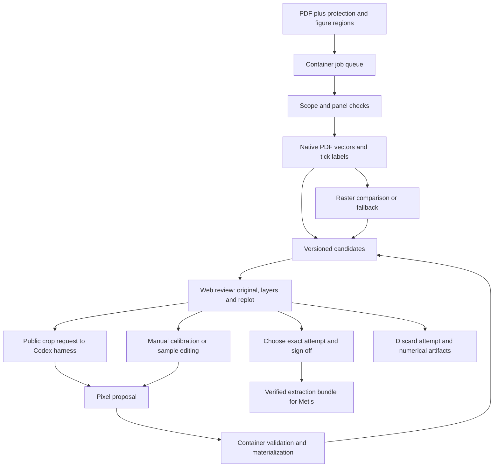

# Lynceus — plot extraction and review

Local prototype for the DAEDALUS ecosystem. Lynceus owns plot extraction attempts;
Metis owns source ingestion, knowledge publication and document sign-off.
The first corpus uses the public ATLAS and CMS PDFs and the existing Docling figure
regions from `source/lab/metis`. Only 1-D XY graphs are candidates for sign-off.

## Start

Clone the standalone repository on another Mac (Git and Docker with Compose are required):

```sh
git clone git@github.com:asalzburger/lynceus.git
cd lynceus
```

Each checkout has its own local runtime database and artifacts. The Git repository
contains code, tests and UI assets; reference PDFs, extraction data and credentials
are transferred or configured separately.

From this directory:

```sh
./scripts/start.sh
```

Open <http://127.0.0.1:3013>. Local demo accounts use password `daedalus`:
`demo_owner` can review; `demo_dev` can build. These are development identities,
not production authentication. The UI reuses DAEDALUS typography, colours and the
Lynceus/Rhadamanthys logo assets.

Prepare the initial corpus once, without modifying Metis:

```sh
python3 scripts/prepare-sources.py
docker compose exec -T api python -m lynceus seed
```

Preparation verifies the frozen source PDF hashes and copies PDFs/crops into
`var/`. Seeding is idempotent. The continuous runner claims the resulting jobs.
Source crops are retained even if every extraction is discarded.

## Extraction hierarchy



| Method | Implementation | Limits |
| --- | --- | --- |
| Vector | PyMuPDF paths, native tick labels, marker shapes, monotonic drawn curves, legend masks, linear/log calibration, some error caps | Conservative frame/tick requirements; complex paths, legends and labels still need review |
| Raster | OpenCV colour/blob/trace detection and Tesseract axis labels; native calibration reused when available | Merged markers, black overlapping series, dense legends and error bars can be incomplete |
| Agent | Explicit per-plot Codex request using the image, selected candidate and bounded conversation; structured pixel proposal | Visual estimates are candidates; public sources only in this prototype |
| Manual | Pick axis references, frame, points and exclusion regions; edit proposal JSON if needed | Reviewer supplies calibration and series identity |

Raster remains a separate candidate even when vectors succeed. If vectors fail,
OCR can establish a raster-only calibration; it requires at least three consistent
printed values per axis. Ambiguous panels/secondary axes are deferred. Multi-panel
figures need a panel-specific region or a calibrated manual/agent proposal.
Raster column samples of drawn lines are labelled as curves, not experimental dots.
Filled distributions are not interpreted as histogram bin counts.

Two useful later methods are **publisher/source-data import** (preserves exact
numbers when an authoritative table exists) and **table extraction**. They should
use this same candidate/review contract. Method agreement can prioritize review;
it does not justify automatic sign-off. Neither importer is implemented here.

## Runner and agent boundary

The API and extraction runner are separate containers. The runner has no network,
runs as a non-root user, has a read-only image, resource limits and temporary
scratch space. Scientific parsing, OCR, pixel validation, numerical conversion and
overlay rendering occur there. No host home directory, Docker socket or model
credentials are mounted into it.

SQLite queue/review state is in the Docker named volume `lynceus_state` at
`/state/lynceus.sqlite3`; source and artifact files are in the bind mount `var/`.
Native volume storage avoids shared-memory/WAL problems on Docker Desktop bind
mounts. Back up both the database and `var/` together while the services are stopped.
The `var/lynceus.sqlite3` left from the initial run is a pre-migration snapshot,
not live state. An additional integrity-checked backup is in `var/backups/`.
Do not use `docker compose down -v` unless intentionally deleting queue/review state.

The model connection uses the existing host Codex harness as the future Talos
boundary; it is not an offline model inside the runner. Only explicitly requested
public plot crops/context enter that connection. Automatic batch extraction does
not invoke an agent. To run the bridge in a terminal:

```sh
./scripts/setup-agent.sh
./scripts/agent-worker.sh
```

This uses the installed, authenticated `codex exec` with ephemeral read-only runs
and structured output. `--model NAME` is optional. Agent output cannot approve or
publish. The network-isolated runner validates it before a new attempt appears.
The bridge is a trusted local development process; production Talos integration
should replace its local token and provide managed identities and job leases.

## Review

Select a source plot, then an attempt. Toggle samples, calibration and exclusion
layers, adjust opacity, or compare other attempts on the same original image.
Active samples are orange; comparison attempts have their own colour keys.
Replot uses the extracted numerical data. A drawn curve remains distinguished
from measured points in the companion diagnostics.

Sign-off requires reviewer identity, a note, and checks for scope, axes, series
identity/completeness and uncertainties. The decision pins the exact manifest
hash and verifies every artifact, the original crop and the source PDF. One
attempt is selected per plot; reselecting a different approved version creates
another explicit decision. Retries never replace or silently approve an attempt.

`Discard Extraction` removes that attempt's data, proposal, geometry and overlays
from active storage and blocks their download. It clears the selection if needed.
Only the decision and artifact hashes remain as audit evidence; discarded samples
are not kept in the audit folder. The source crop and other attempts remain.
Copies already downloaded or external filesystem backups are outside this action.

No ATLAS/CMS extraction is automatically signed off. An extraction sign-off is
separate from Metis document approval and does not publish anything to the KB.

## CLI and integration

For a new local PDF copied into `var/uploads/`:

```sh
docker compose exec -T api python -m lynceus ingest /data/uploads/example.pdf --public --title Example
```

Use `--protection-file /data/policy.json` instead of `--public` for a validated
Metis protection object. `--source-uri` records the canonical file/HTTP source
link; this CLI reads a local PDF and does not fetch remote URLs. `--regions`
accepts a JSON array of `{ "page": 1, "bbox": [left, top, right, bottom],
"caption": "..." }`. Coordinates are top-left PDF points, pages are one-based.
Without regions, the runner discovers native framed XY panels; automatic scanned
page figure discovery is not implemented. Metis/Docling can provide those regions.

The authenticated API supports PDF upload, explicit regions, queued extraction,
manual proposals, agent requests, decisions and selected extraction export.
See `/docs` for request schemas. Mutations use the session's `x-csrf-token`.
Source permissions guard catalogs, images, artifact downloads and agent requests.
Restricted agreement checks are enforced, but the demo has no agreement
enrollment/identity administration UI.

Contracts:

- `lynceus.pixel-proposal/v1`: top-left image pixels, frame, linear/log reference
  anchors, series, masks and warnings; validated and converted in the runner.
- `daedalus.plot/v1`: the existing strict numerical plot format. Additional
  provenance and error-bound details stay in companion files.
- `rhadamanthys.decision/v1`: local review receipt for an exact attempt hash.
- `lynceus.metis-bundle/v1`: selected, approved attempt ZIP with source identity,
  inherited protection, all artifacts, crop and decision; document sign-off remains
  required.

`lynceus.client.read_bundle(path, expected_pdf_sha256, expected_protection)` is the
Metis-side verification entry point. It checks the selected approval, manifest and
file hashes, source hash, inherited policy and numerical envelope. Receipts have
integrity hashes, not an external signature or identity attestation. Metis must
obtain bundles from a trusted Lynceus endpoint and retain its own approval gate.
This prototype does **not** write to the current Metis database or replace its
frozen reviews. Wiring that importer is the next integration step.

## Validation

```sh
docker compose run --rm --no-deps -T -e LYNCEUS_DATA=/tmp/lynceus-test api python -m pytest -q -p no:cacheprovider
```

Tests use isolated fixture data and a temporary database, including approvals and
discard, so they never sign off or delete the reference corpus. They cover native
and raster extraction, raster-only OCR and saturated colour, exact-version review,
tamper detection, bundle verification, source policy, CSRF and agent completion.
The first public corpus report is in `var/first-round-report.json`.

This remains a development workbench: no central Rhadamanthys service, Theseus
scheduler, production identity integration, arbitrary plot-type support or
automatic scientific verification is claimed.
